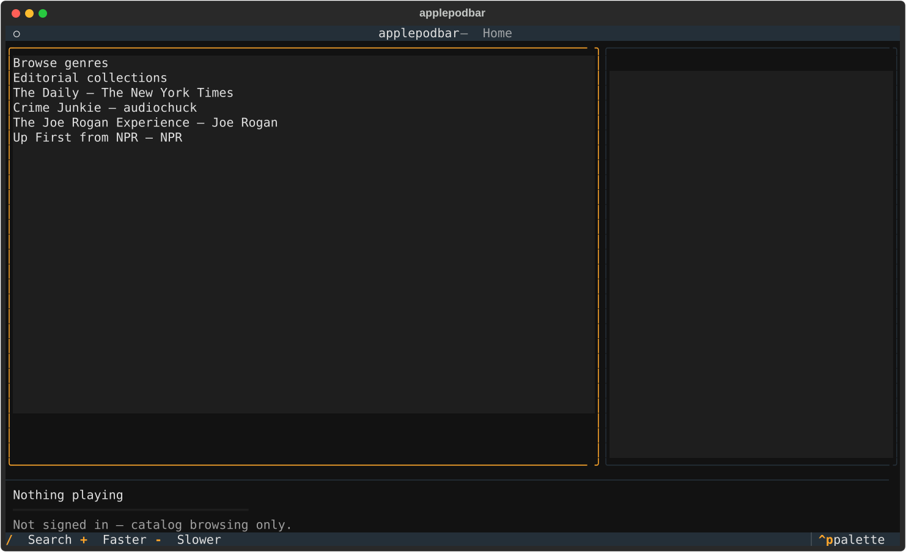

# applepodbar

A keyboard-driven terminal podcast player for [Apple
Podcasts](https://podcasts.apple.com), built with Python and
[Textual](https://textual.textualize.io/).

> [!IMPORTANT]
> applepodbar is an independent, early-stage project and is not affiliated with
> or endorsed by Apple. It uses the undocumented AMP API that backs the
> podcasts.apple.com web player, so Apple can change or withdraw it without
> notice. No DRM bypass is implemented — applepodbar plays only the plain audio
> URLs the web player itself receives.

## Status

Early. Home charts, genre/editorial browse, search, show detail, and free-episode
playback are wired to the AMP catalog. Playwright login is available as an
optional extra. If Apple's web token cannot be found, search and playback fall
back to iTunes Search and publisher RSS. Signed-in Library, Up Next, and
cross-device playback-position sync, and follow/save actions are now wired.
Paid FairPlay content remains out of scope; see [`docs/SPEC.md`](docs/SPEC.md).



## Features

- Browse and search the Apple Podcasts catalog; play free episodes through `mpv`
- Signed-in Library, Up Next, follows/saves, and cross-device position sync
- Zero-auth iTunes Search + RSS fallback with local follows and resume positions
- Paid FairPlay episodes are listed but not playable

## Requirements

- Python 3.12+
- [`uv`](https://docs.astral.sh/uv/)
- [`mpv`](https://mpv.io/) on `PATH` (needed for playback; browsing works
  without it)
- An Apple account, only for the signed-in features

## Install

```bash
# From a local checkout (not yet published to PyPI):
uv tool install --from . applepodbar
applepodbar
```

## Installation for development

```bash
git clone git@github.com:feoh/applepodbar.git
cd applepodbar
uv sync
uv run applepodbar
```

## Signing in

Catalog browsing, search, and playback of free episodes need no sign-in at all.

Library, Up Next, and position sync need a per-user token. applepodbar captures
it once by opening a real browser window for you to sign in to Apple yourself —
**it never sees or stores your Apple ID password.** This needs the optional
`login` extra:

```bash
uv sync --extra login
uv run playwright install chromium
uv run applepodbar login
```

## Configuration

Configuration lives in the platform-standard user config directory:

```
<config_dir>/applepodbar/
  config.toml          storefront and playback preferences
  tokens.json          cached developer JWT, written user-only (mode 600)
  local_library.json   local follows and RSS resume positions (mode 600)
OS keyring             media-user-token and browser session cookies
```

Set `[general] catalog_backend = "rss"` in `config.toml` to avoid the private
API altogether. In RSS mode, press `a` on a show to follow it locally; `l`
lists locally followed shows. Resume positions stay on this device.

The installed tool can enable login with `uv tool install --from . --with keyring
--with playwright applepodbar`; install its Chromium browser separately via
`uv run --with playwright playwright install chromium` or use the development
checkout commands above. Linux keyring support requires an unlocked Secret
Service backend. No account password is handled by applepodbar.

## Development

```bash
uv run pytest -q
uv run ruff check src tests
uv run ruff format --check src tests
uv run mypy src/applepodbar tests
uv run pyright
uvx prek run --all-files
uv build
```

## Releasing

Publishing a GitHub release runs `.github/workflows/publish.yml`, which re-runs
the checks, builds, and uploads to PyPI through trusted publishing (no API
token). The release tag must be `v` plus the `pyproject.toml` version:

```bash
uv version --bump patch        # or minor / major
git commit -am "Release v$(uv version --short)"
git push
gh release create "v$(uv version --short)" --generate-notes
```

## License

MIT — see [LICENSE](LICENSE).
